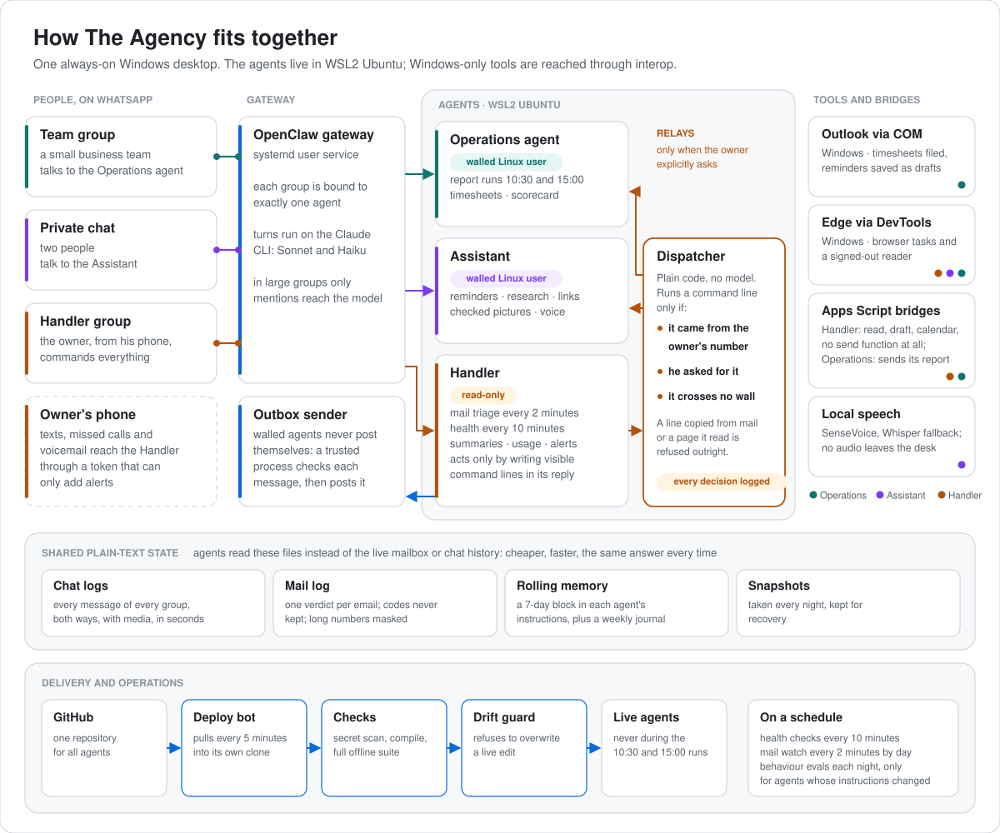

# Architecture

## One machine, two worlds

An always-on Windows desktop runs everything. The agents live in **WSL2 Ubuntu**. The things only
Windows can do (Outlook through COM, a visible Edge browser, scheduled tasks in the logged-in user's
session) live on the **Windows** side and are reached through WSL interop.

<picture>
  <source media="(prefers-color-scheme: dark)" srcset="diagrams/architecture-dark.svg">
  
</picture>

## How a message becomes work

1. The gateway routes each WhatsApp group to exactly one agent (bindings) and runs each turn through the
   Claude CLI. In large groups, only messages that mention the agent reach the model.
2. The agent's instruction files are loaded with the turn. Some blocks in them are generated, and a test
   fails a deploy if an instruction repeats something that is no longer true.
3. Anything that needs doing is a command line, not a free tool call. The dispatcher decides it.
4. Code posts results straight to the group. The model never retells a code result, so a number it did
   not compute never reaches a person.

## Key pieces

- **Walls.** Agents run their model turns as separate Linux users with their own allow-lists, so they
  cannot read each other's files or the Handler's. Anything an agent needs to send leaves through an
  outbox that a small trusted sender process checks and posts.
- **Handler pattern.** The Handler is read-only. To act, it writes a visible line such as `🔧 status: all` in its
  reply; a dispatcher runs it only if the triggering message came from the owner's own number. Relays to
  other agents need an explicit ask, and a topic guard keeps personal subjects from crossing between
  agents.
- **Logs instead of live reads.** The mail watch writes every new email to a plain-text log with its
  verdict, and the chat logger writes every group message within seconds (a file watcher, with a nightly
  run as the safety net). Agents read these files instead of calling the mailbox or the chat history, which
  is faster, cheaper, and the same answer every time.
- **Browser automation without the cloud.** Dedicated Edge profiles, driven by a small standard-library
  Chrome DevTools Protocol client. Windows open on demand through interactive scheduled tasks, so they land
  in the user's desktop session rather than the hidden service session, and close themselves after 10
  idle minutes to save memory.
- **Outlook automation.** A scheduled task in the user's session runs a PowerShell and VBScript bridge
  that syncs, reads timesheet emails and saves reminder drafts. It starts Outlook only if it is closed and
  quits it gracefully.
- **Local speech.** Voice notes are transcribed on the desktop with SenseVoice, with Whisper as the
  fallback. No audio leaves the machine and no model tokens are spent.
- **Memory.** A keeper job writes a rolling 7-day conversation block into each agent's instructions every
  10 minutes, plus a weekly summarised journal, so long-running chats keep their context without huge
  sessions.
- **Delivery.** One GitHub repository for all agents and a pull-based deploy bot on the desktop. See
  [engineering.md](engineering.md).

## Why a desktop and not the cloud

Outlook and the sites the agents use need a real Windows desktop session. Running everything on one
always-on machine keeps the browser, the mail client, the speech models and the agents side by side, with
no cloud servers to pay for or secure. The price is that host failures look like agent failures, so the
first checks when every agent goes quiet are the host's: disk space, network and the runtime's login.
